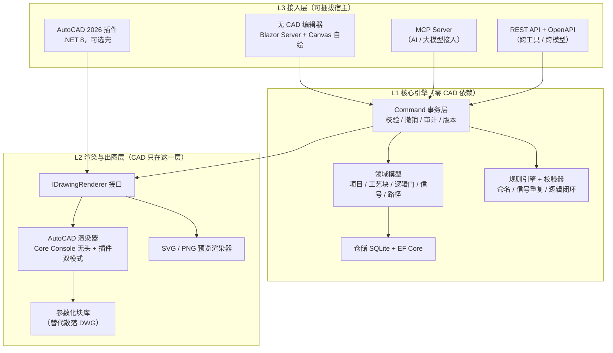

# BID2015 重构计划书 V1.0

| 项 | 内容 |
|---|---|
| 文档版本 | V1.0 |
| 日期 | 2026-10-16 |
| 对象系统 | BID2015（水泥厂仪表/控制逻辑图、联锁图 AutoCAD 绘图工具） |
| 状态 | **待评审**（未立项、未开工） |
| 评审方式 | 跨工具 / 跨模型评审。第 2、10、11 章自包含，可直接复制给评审方 |
| 素材来源 | `BID_Debug.rar` 解包 + 反编译源码 + 配置文件，全部结论附文件/行号 |

## 修订记录

| 版本 | 日期 | 说明 |
|---|---|---|
| V1.0 | 2026-10-16 | 初版。基于反编译分析形成架构设计与实施计划 |

---

# 1. 目的与范围

## 1.1 目的
把现有 BID2015 从"必须绑定 AutoCAD 2015 + VB.NET + XML 文件"的单机工具，重构为：

1. **核心引擎与 CAD 彻底解耦**，可在无 CAD 环境下运行；
2. **出图环节支持新版 AutoCAD**（2026），并支持无头批处理；
3. **预留标准 AI 操作接口**，使大模型可以读项目、改项目、触发校验与出图；
4. 输出物仍为符合企业标准的 **CAD 版（DWG）图纸**，保证施工/调试可用。

## 1.2 范围

**在范围内：** 领域模型重建、数据层重建、规则与校验、AI 接口、渲染/出图层、交互层、历史项目迁移、验收。

**不在范围内（V1 明确不做）：**
- 云端 SaaS 化、多人在线协同编辑（架构预留，不实现）；
- 对接 DCS/PLC 组态软件的信号自动导入（接口预留，不实现）；
- 三维/厂区布置图（本系统只出逻辑图与联锁图）。

---

# 2. 背景资料（现状基线）

> 本章所有结论来自对 `BID_Debug.rar` 的解包与反编译，方法：`node-unrar-js` 解包 → `rea inspect-managed-artifact` 身份识别 → `ilspycmd` 反编译为 C# 工程。证据以「文件:行号」标注，可复核。

## 2.1 系统构成

| 组成 | 说明 | 来源 |
|---|---|---|
| `BID2015.exe` | 主程序，VB.NET WinForms，.NET Framework 4.0 / x86，ClickOnce 部署 | `BID2015.application`、`BID2015.xml` |
| `LineJig.dll` | CAD 端自定义命令 `BIDLL`（逻辑线）/ `BIDPL`（二折线）的实现载体 | `PublicModule.cs:27-29`、`PublicModule.cs:139` |
| `DWG_PRINT2015.exe` | 外部打印程序，主程序以常量名调用 | `PublicModule.cs:37` |
| `DotNetARX.dll` | 第三方 AutoCAD .NET 辅助库，**非本项目代码**，仅被引用 | 反编译产物 |
| `templet/` | 图块库：标准图块 18 个、典型设备 30+ 个、图框若干 | 解包清单 |
| `DB/config.xml` | 设备类型 → 输出标签模板，18 种设备类型 | `DB/config.xml:1-118` |

## 2.2 关键事实数字

| 项 | 值 | 来源 |
|---|---|---|
| 逻辑门数量 | 5 | `PublicModule.cs:39` |
| 每门输入量 | 4 | `PublicModule.cs:40` |
| 逻辑输入总量 | 20 | `PublicModule.cs:41` |
| 图纸尺寸 | 42000 × 29700（A3，按 ×100 绘图单位） | `PublicModule.cs:45-46` |
| 图纸排布间隔 | X=50400，Y=44550 | `PublicModule.cs:49-50` |
| 单行图纸张数 | 10 | `PublicModule.cs:53` |
| 逻辑线图层 | `Logic_connect`，青色 | `PublicModule.cs:55`、`PublicModule.cs:457-458` |
| 标准字体 | `SINOMA(NJ)` | `PublicModule.cs:57` |
| 图框文件 | `Sinoma_Frame_A3ENG.dwg` | `PublicModule.cs:33` |
| 业务模块数 | 21 个源码文件（12 个 Form + 领域/数据类 + 公共模块） | 源码清单 |

## 2.3 设备类型与输出标签模板（部分，共 18 种）

`<$>` 为工艺编号通配符，模板自动展开生成输出信号名。

| 设备类型 | 输出标签模板 | 单驱动 |
|---|---|---|
| Group组 | `<$>_GSTR;<$>_GSTP;<$>_GRUN` | 是 |
| 单向电机【含速度】 | `<$>_RUN` | 是 |
| 双向电机【含速度】 | `<$>_CRUN;<$>_ARUN` | — |
| 单驱动气动阀电磁阀 | `<$>_OPEN;<$>_CLOSE` | 是 |
| 执行器 | `<$>_MAX;<$>_MIN;<$>_POS` | — |
| 电动三通阀 | `<$>_POS1;<$>_POS2` | — |
| 模拟三通阀 | `<$>_POS1;<$>_POS2;<$>_POS` | — |

来源：`DB/config.xml:1-118`。

## 2.4 CAD 耦合点清单（重构的真正工作量）

| 编号 | 耦合点 | 代码位置 | 性质 |
|---|---|---|---|
| C1 | `Interaction.GetObject(null, "AutoCAD.Application")` 接管运行中的 CAD | `PublicModule.cs:117-127` | 进程级强绑定 |
| C2 | `SendCommand` 拼 `(command "NETLOAD" ".../LineJig.dll")` | `PublicModule.cs:139` | 字符串命令，脆弱 |
| C3 | `SendCommand` 发 `BIDLL` / `BIDPL` 画逻辑线 | `PublicModule.cs:452-473` | 字符串命令 |
| C4 | `ModelSpace.InsertBlock(...与门001.dwg, 1,1,1,0)` | `Form_绘图工具.cs:900,919,938,957,985` | 外部块文件依赖 |
| C5 | `SelectionSets.SelectOnScreen / Select`，DXF 组码过滤 `0=INSERT`、`2=块名` | `PublicModule.cs:195-324` | 屏幕交互 |
| C6 | `GetBoundingBox` + `WholeIn` 判断块归属哪个图框 | `PublicModule.cs:326-377` | 几何计算 |
| C7 | `AcadAttributeReference` 读写 `TagString/TextString/ScaleFactor`，按 Tag 中 `:长度` 自动缩字号 | `PublicModule.cs:392-450` | 属性驱动 |
| C8 | `GetXData / SetXData` 扩展数据读写 | `Class_BID块.cs:766-879` | 数据回写 |
| C9 | `Class_BID块 : AcadBlockReference` 领域类直接继承 COM 对象 | `Class_BID块.cs:9` | 领域模型被污染 |
| C10 | `CAD句柄`（Handle）作为图纸↔数据关联键 | `项目DataSet.cs:125` | 双向绑定 |
| C11 | 隐藏全部窗口 + `AppActivate` 把屏幕让给 CAD | `PublicModule.cs:169-193, 379-390` | 交互 hack |

## 2.5 数据模型（现状）

三个强类型 DataSet，**存储为纯 XML，无数据库、无并发、无版本、无审计**。

**（1）`项目DataSet.DT流程块`** —— 主表，窄表设计严重：

- 标识：显示编号 / 序号 / 工艺编号 / 工艺名称 / 所属组号 / 所属组名 / 设备类型（`项目DataSet.cs:39-52`）
- 路径：`路径选择1..8` / `路径名称1..8` / `路径1..8正向运行`，固定 8 列（`项目DataSet.cs:53-100`）
- 逻辑输入：`STL1_IN`、`STL2_IN`、`OPL1_IN`、`OPL2_IN`、`PRL1_IN`、`PRL2_IN`、`STR1_IN`、`STR2_IN`、`STP_IN`（`项目DataSet.cs:101-119`）
- 备用字段 ×3、`CAD句柄`（`项目DataSet.cs:119-125`）

**（2）`DataSet1.临时操作连锁1`** —— PRL 组展开为 5 门 × 每门 4 输入的平铺列：

- `PRL_门{1..5}_ONDL{1..4}` 开延时、`PRL_门{1..5}_OFFDL{1..4}` 关延时、`PRL_门{1..5}_IN{1..4}` 输入、`PRL_门{1..5}_NOT{1..4}` 取反（`DataSet1.cs:45-161` 起，模式延续）
- **这是最典型的需要规范化为子表的结构**：5×4×4 = 80 列表达一个本该是「门→输入」两层的模型。

**（3）`设置DataSet.DT设备类型`** —— 18 种设备类型 + 输出标签模板 + 单驱动标志（`DB/config.xml`）。

## 2.6 部署与硬约束

- **必须先打开 AutoCAD 才能使用**；未打开则 `MsgBox` 报错并中止（`PublicModule.cs:107,128,136,146`）
- 原配 AutoCAD 2015（程序名 + PIA 版本）
- 本机现装 AutoCAD 2026（注册表 `R25.1`，用户环境记录 2026-09-18 实测）→ **新版 CAD 验证环境已就绪**
- 字体、图框、图层名均为企业标准硬编码

## 2.7 已知代码质量缺陷（反编译时发现，重构应一并消除）

| # | 问题 | 位置 | 风险 |
|---|---|---|---|
| Q1 | `Func_画逻辑线` 第二个重载用 `double.ToString()` 直接拼坐标，未做 `"0.0"` 格式化 | `PublicModule.cs:464-473` | 科学计数法/小数点导致 CAD 命令解析失败 |
| Q2 | 全部 CAD 命令靠字符串拼接，源码注释自承"CAD 有执行未结束的操作命令"时会失败 | `PublicModule.cs:145` | 稳定性差 |
| Q3 | `Glob_隐藏窗口List` 在显示窗口时用 `Add` 而非 `Clear`，列表累积 | `PublicModule.cs:184-191` | 内存与逻辑错误 |
| Q4 | 大量 `On Error Resume Next` 风格的 try/catch 吞异常，仅弹框 | 全模块 | 故障难定位 |

---

# 3. 重构目标 → 设计对策

| 诉求 | 设计对策 | 落点 |
|---|---|---|
| 融合最新技术 | .NET 8 + EF Core + SQLite + MCP 协议 + Blazor | 全栈 |
| 预留 AI 操作接口 | Command 事务层 + MCP Server + 项目 JSON Schema；AI 与人走同一入口 | 核心引擎 |
| 在最新版 CAD 运行 | 以 AutoCAD 2026 .NET API 重写插件（.NET 8），弃用 COM/PIA | 出图层 |
| 离开 CAD 运行、最后输出 CAD 版 | 核心零 CAD 依赖；出图走 AutoCAD Core Console 无头执行 | 核心 + 出图层 |
| 保持图纸企业标准 | 图框/字体/图层/属性位参数化，纳入版本管理 | 渲染层 |

---

# 4. 新架构

## 4.1 架构图



## 4.2 五条设计原则

1. **领域模型不继承任何 CAD 类型**（消灭 C9）。`工艺块`/`逻辑门`/`信号` 为纯 POCO；`CAD句柄` 降级为渲染产物元数据，可空、可回写、不是主键。
2. **所有写操作（人 / AI / 批量导入）必须经过 Command 层**。这是 AI 安全与企业审计的地基，没有例外路径。
3. **渲染接口唯一**。UI 预览与 CAD 出图共用同一份中性「图面描述」（Drawing Script），保证"屏上所见 = DWG 所得"。
4. **旧数据只进不出**。历史 XML 通过导入器进入新模型；新系统不再产出 XML 数据文件。
5. **企业标准集中管控**。图框、字体、图层、属性位、命名规则全部参数化并纳入版本库，消灭散落的 `.bak`。

## 4.3 Solution 结构

```
BID.Core/                    # 领域模型 + 规则 + Command 层（零 CAD 引用）
BID.Data/                    # EF Core + SQLite + 迁移 + 旧 XML 导入器
BID.Rendering/               # IDrawingRenderer + 中性图面描述 + SVG 渲染
BID.Rendering.AutoCAD/       # AutoCAD 2026 渲染器（net8，引用 AcMgd/AcDbMgd）
BID.Headless/                # Core Console 入口（无头出图 CLI）
BID.Plugin/                  # AutoCAD 插件壳（命令 BIDxxx）
BID.Api/                     # ASP.NET Core Minimal API + OpenAPI
BID.Mcp/                     # MCP Server（stdio + http）
BID.Web/                     # Blazor Server 前端
BID.Tests/                   # 核心规则单测（不依赖 CAD，可进 CI）
```

---

# 5. 技术选型

| 层 | 选型 | 理由 | 待验证 |
|---|---|---|---|
| 核心引擎 | **C# / .NET 8** | AutoCAD 2026 的 .NET API 基于 .NET 8，统一目标框架最省事；AI 生成 C# 质量显著高于 VB | 本机仅装 dotnet 10 SDK，需补 8.x SDK 与 targeting pack |
| 数据 | **SQLite + EF Core** | 单文件、免服务、易备份、支持多项目；仓储接口抽象，将来可换 PostgreSQL | — |
| AI 协议 | **MCP（本地 stdio）为主 + REST 为辅** | 本机已有 MCP 基建（cad-mcp 等）；REST 供其他工具/模型接入 | MCP 需按现行协议版本实现 |
| 无 CAD 预览 | **自绘 Canvas / SVG** | 逻辑图本质是块+线+属性，无需 CAD 内核 | — |
| 新版 CAD 出图 | **AutoCAD Core Console（accoreconsole.exe）无头** | CAD 内核出图，兼容性 100%；无需打开 CAD 界面；可批处理/服务化 | **需实测**（见 U2） |
| 备选出图 | ODA Drawings SDK（商业）/ ACadSharp（开源） | ODA 能力最全但需授权；ACadSharp 纯托管但块/属性写支持有限 | **需 spike**（见 U3） |
| 前端 | **Blazor Server**（备选 WinForms 快速迁移） | Blazor 天然可被 API/AI 驱动；WinForms 对你学习成本最低 | 决策点 D2 |

**为什么不延续 VB.NET：** 新版 CAD .NET API 文档与生态以 C# 为主；且"AI 能改这个软件"这一诉求直接依赖 AI 的代码生成质量，C# 优势是决定性的。VB 反编译产物保留作业务对照，不作为新代码基础。

---

# 6. AI 接口设计

## 6.1 设计定位

AI 接口**不是外挂聊天窗，而是核心引擎的正规入口层**。AI 与人走同一个 Command 事务层，因此天然获得校验、撤销、审计。

## 6.2 项目文档格式（AI 与系统的唯一契约）

```json
{
  "project": { "id": "P-2026-014", "name": "××水泥线烧成系统", "rev": 3 },
  "devices": [{
    "tag": "C-101",
    "deviceType": "单向电机【含速度】",
    "outputs": ["C-101_RUN"],
    "group": "G-01",
    "logic": {
      "gates": [
        { "type": "AND", "inputs": [
            { "signal": "C-101_RUN",  "onDelay": 2, "invert": false },
            { "signal": "X-205_OPEN", "onDelay": 0, "invert": true }
        ]}
      ]
    },
    "paths": { "selection": [1, 2], "names": ["主线", "旁路"] }
  }],
  "sheets": [{ "name": "连锁图-01", "devices": ["C-101", "X-205"] }]
}
```

> `outputs` 由设备类型模板自动展开（对应 §2.3），AI 不必手填，避免与 `config.xml` 规则不一致。

## 6.3 工具集（MCP / Function Calling 友好）

| 工具 | 作用 | 安全等级 |
|---|---|---|
| `project.open / save / list` | 项目读写 | 读 / 写 |
| `device.create / update / delete` | 工艺块增删改 | 写（过校验） |
| `gate.setLogic` | 设置门类型与输入（与/或/非/异或/RS/PID） | 写 |
| `signal.link` | 连接信号 | 写 |
| `rules.validate` | 运行全部校验，返回问题清单 | 只读 |
| `project.explain` | 把某设备/某联锁翻译成人话（反哺现场与新人） | 只读 |
| `drawing.generate` | 触发出图（Core Console 或插件） | 写（重操作） |
| `template.list` | 列出可用块模板与设备类型 | 只读 |
| `migration.importXml` | 导入旧版 XML 项目 | 写 |

## 6.4 三条硬规矩

1. **AI 写操作必须走 Command 层**，禁止直连数据库——否则撤销、审计、校验全部失效。
2. **AI 不直接写 DWG**，只能改项目模型；出图统一走渲染层，防止 AI 产出不可控图纸。
3. **重操作（出图 / 打印）默认 dry-run**，需人工确认开关才真正执行。

---

# 7. 出图方案对比与选型

| 方案 | 原理 | 优点 | 缺点 | 结论 |
|---|---|---|---|---|
| **A. Core Console** | `accoreconsole.exe` 无头跑脚本，NETLOAD 我们的 net8 程序集，执行 InsertBlock / 属性 / 打印 | CAD 内核，兼容性 100%；无需打开界面；可批处理 | 需安装 AutoCAD；命令行调试不便；net8 DLL 加载待实测 | **首选** |
| **B. CAD 插件（双宿主）** | 同一渲染 DLL，在 CAD 内 NETLOAD / Bundle 加载 | 图纸精修体验好；兼容老操作习惯 | 依赖已打开的 CAD 会话 | 与 A 并存，非二选一 |
| **C. 纯托管写 DWG** | ACadSharp / ezdxf 直接生成 DWG | 彻底脱离 CAD，可上云 | 块/属性/图层/中文字体支持风险高；能力未验证 | 仅作远期逃生舱，V1 不做 |

**选型结论：A + B 共用同一 `BID.Rendering.AutoCAD`。** 日常批量出图不需要人盯着 CAD；需要精修时在 CAD 里用插件。

**涉密约束（建议写入架构决策记录）：** 水泥厂图纸涉密，**不建议使用 Autodesk 云 API（AutoCAD I/O）出图**，数据会离开内网。

---

# 8. 数据模型与迁移

## 8.1 新模型（建议表）

`Project` / `Device` / `Gate` / `GateInput` / `Signal` / `Path` / `Sheet` / `BlockTemplate` / `DeviceType` / `DrawingRevision` / `AuditLog`

## 8.2 关键迁移映射

| 旧结构 | 新结构 | 说明 |
|---|---|---|
| `DT流程块.路径选择1..8 / 路径名称1..8 / 路径1..8正向运行` | `Device 1—N Path` 子表 | 消灭固定 8 列窄表 |
| `临时操作连锁1` 的 `PRL_门{1..5}_{ONDL,OFFDL,IN,NOT}{1..4}` | `Gate 1—N GateInput`，延时与取反成为输入属性 | 80+ 列塌缩为两层模型 |
| `DT流程块.STL/OPL/PRL/STR/STP_*_IN` | `Gate.type` + `GateInput.signal` | 语义显式化 |
| `CAD句柄` | `Device.cadHandle`（可空，渲染回填） | 降级为元数据 |
| `设置DataSet.DT设备类型` / `DB/config.xml` | `DeviceType` 表 + 标签模板字段 | 入库，可版本化管理 |

## 8.3 迁移约束

- 导入必须**逐字段可追溯**，任何无法映射的字段不得静默丢弃，须产出迁移报告。
- 首批用 3 个真实历史项目双跑比对，逐张 DWG 比对差异，通过后才切换。
- `DataSet1` 字段已确认（§2.5），不再列为未知项；但仍需确认其在业务上的触发条件（何时写入）。

---

# 9. 实施计划（任务树）

> 编号规则：阶段.序号。Ask 模式无法落盘建树，本表即计划；切 Agent 模式后可按 `AI任务管理\任务树模板.md` 建成可勾选树。

## L1 基线与验证（先做，约 2 人周）

| 编号 | 任务 | 产出 | 完成判据 |
|---|---|---|---|
| L1-1.1 | 补读未读模块：`Form连锁图`、`Form_交叉索引`、`Form_出图清单`、`DWG_PRINT2015` | 流程补充说明 | 输出链路完整 documented |
| L1-1.2 | **技术 spike（本机 AutoCAD 2026 可验）**：Core Console 无头 NETLOAD net8 DLL → InsertBlock → 写属性 → 打印 PDF；同步 spike ACadSharp 写块能力 | 验证报告 | U2/U3 有确定结论 |
| L1-1.3 | 领域模型 Schema v0.1 + 旧 XML 字段映射表 | Schema + 映射表 | 覆盖 §8.2 全部映射 |
| L1-1.4 | 查证 AutoCAD 2026 的 .NET 目标框架版本（Autodesk 官方文档） | 结论记录 | U1 关闭 |

## L2 核心引擎（约 6–8 人周）

| 编号 | 任务 | 产出 |
|---|---|---|
| L2-2.1 | POCO 领域模型 + 规则引擎（5 门×4 输入、STL/OPL/PRL/STR/STP 语义） | `BID.Core` |
| L2-2.2 | 校验器：命名规则、信号重复、输出标签与设备类型一致性、逻辑闭环 | 校验规则集 + 单测 |
| L2-2.3 | EF Core + SQLite 仓储 + 迁移 | `BID.Data` |
| L2-2.4 | Command 事务层 + 撤销 + AuditLog | 事务内核 |
| L2-2.5 | 旧 XML 导入器 | 迁移报告产出 |

## L3 AI 接口（约 3–4 人周）

| 编号 | 任务 | 产出 |
|---|---|---|
| L3-3.1 | 项目 JSON Schema v1.0 定稿 | Schema + 示例 |
| L3-3.2 | MCP Server 工具集（§6.3 九项） | `BID.Mcp` |
| L3-3.3 | REST API + OpenAPI 文档 | `BID.Api` |
| L3-3.4 | `project.explain` 联锁→自然语言反解 | 解释器 |

## L4 渲染与出图（约 8–12 人周，最重）

| 编号 | 任务 | 产出 |
|---|---|---|
| L4-4.1 | `IDrawingRenderer` + 中性图面描述 | 渲染抽象 |
| L4-4.2 | SVG 预览渲染器 | 无 CAD 看图能力 |
| L4-4.3 | AutoCAD 渲染器（插件 + Core Console 双模式） | `BID.Rendering.AutoCAD` |
| L4-4.4 | **参数化块库重构**（18 标准块 + 30 典型设备 + 43 属性位） | 参数化块库 + 元数据 |
| L4-4.5 | 打印集成（替代 `DWG_PRINT2015.exe`） | 打印管线 |

## L5 交互（约 4–6 人周）

| 编号 | 任务 | 产出 |
|---|---|---|
| L5-5.1 | 无 CAD 编辑器（形态见 D2） | 编辑器 |
| L5-5.2 | 逻辑图可视化编辑（拖门、连信号） | 编辑能力 |

## L6 验收（约 3–4 人周）

| 编号 | 任务 | 完成判据 |
|---|---|---|
| L6-6.1 | 3 个历史项目迁移双跑，逐张 DWG 比对 | 差异清单归零或可解释 |
| L6-6.2 | 图签/字体/图层/属性符合 Sinoma 标准人工评审 | 签字确认 |
| L6-6.3 | 交接文档 + 培训 | 交付 |

## 9.1 工作量粗估（**未经 WBS 详细分解，仅供定预算量级**）

| 方案 | 合计人周 |
|---|---|
| 完整方案（含参数化块库重构 L4-4.4） | 约 26–38 人周 |
| 轻量方案（**保留现有 DWG 图块原样复用**，L4 降至 4–6 人周） | 约 20–25 人周 |

**轻量方案的取舍：** 图块库不改，仅在外层套新架构。好处是 CAD 兼容性风险最低、出图路线最快跑通；代价是"散落 DWG + .bak"的老问题延续，参数化与版本管理留到 V2。**建议 V1 走轻量方案，把参数化块库单独作为 V2 项目。** 这一条列入评审决策点 D9。

---

# 10. 风险与未验证假设

| 编号 | 假设 / 风险 | 影响 | 关闭方式 |
|---|---|---|---|
| U1 | AutoCAD 2026 .NET API 可用 .NET 8 开发 | 高，决定技术栈 | L1-1.4 查官方文档 |
| U2 | Core Console 能无头加载 net8 DLL 并完成 InsertBlock/属性/打印 | **最高，直接决定"离开 CAD"能否成立** | L1-1.2 本机实测 |
| U3 | ACadSharp 能写带属性的块 | 中，决定逃生舱可行性 | L1-1.2 spike |
| U4 | 43 个 CAD 属性位可被参数化重建 | 高，工作量集中点 | L4-4.4 人工核对（V2） |
| U5 | `DataSet1` 的业务触发条件（何时写入） | 中 | L1-1.1 |
| U6 | 典型设备 DWG 中 `@RT` 后缀版本与普通版差异 | 低 | 需打开 DWG 查看，**未查证** |
| U7 | Sinoma 图框、`SINOMA(NJ)` 字体授权可延续 | 中 | 需你确认 |
| U8 | 老用户能否接受不再"接管已打开 CAD" | 中，变革管理 | 决策点 D6 |
| U9 | 本机需补装 .NET 8 SDK（现为 dotnet 10） | 低 | 安装即可 |

---

# 11. 评审决策点

| ID | 决策 | 选项 | 本文建议 |
|---|---|---|---|
| D1 | 语言 | C# net8 全栈 / C# 核心 + VB 迁移壳 | C# net8 全栈 |
| D2 | UI 形态 | Blazor Web（AI 友好、跨平台）/ WinForms（上手最快） | Blazor；尊重学习成本可退 WinForms |
| D3 | 存储 | SQLite 单机 / PostgreSQL 多人 | SQLite 起步，接口留 PostgreSQL |
| D4 | 出图路线 | A Core Console / B 插件 / C 纯托管 | A 为主 + B 并存；C 仅 spike |
| D5 | AI 接入形态 | 本地 MCP / REST / 两者 | MCP 主 + REST 辅 |
| D6 | 是否保留"接管已打开 CAD" | 保留（兼容）/ 彻底无头 | 保留为插件模式，但非默认路径 |
| D7 | 迁移策略 | 并行双跑 / 直接切换 | 并行双跑，验收后才切换 |
| D8 | 命名与代码语言 | 中文延续 / 模型英文化 + 注释中文 | 后者（利于 AI 生成与维护） |
| D9 | **V1 是否含参数化块库重构** | 含（完整方案）/ 不含（轻量方案） | **不含，留作 V2** |

---

# 12. 附录：来源索引

| 类别 | 路径 |
|---|---|
| 解包产物 | `D:/BID_Debug/extracted/Debug/` |
| 反编译源码（C#） | `D:/BID_Debug/_rea/decompiled/{BID2015,LineJig,DWG_PRINT2015,DotNetARX}` |
| 反编译源码（VB 版） | `D:/BID_Debug/_rea/decompiled_vb/` |
| 逆向分析报告 | `D:/BID_Debug/_rea/REA_报告.md` |
| VB 版说明 | `D:/BID_Debug/_rea/VB_反编译说明.md` |
| 设备类型配置 | `D:/BID_Debug/extracted/Debug/DB/config.xml` |
| 图块库 | `D:/BID_Debug/extracted/Debug/templet/` |

## 本计划书自身的边界

- 第 2 章事实全部来自反编译与配置文件的静态分析，**未在运行的 AutoCAD 中验证过行为**。
- 第 5、7 章涉及新版 CAD 与第三方库能力的部分，均已标注待验证项（U1–U3），**不得在验证前当作确定结论使用**。
- 第 9.1 节工作量数字为粗估量级，不是承诺工期。
