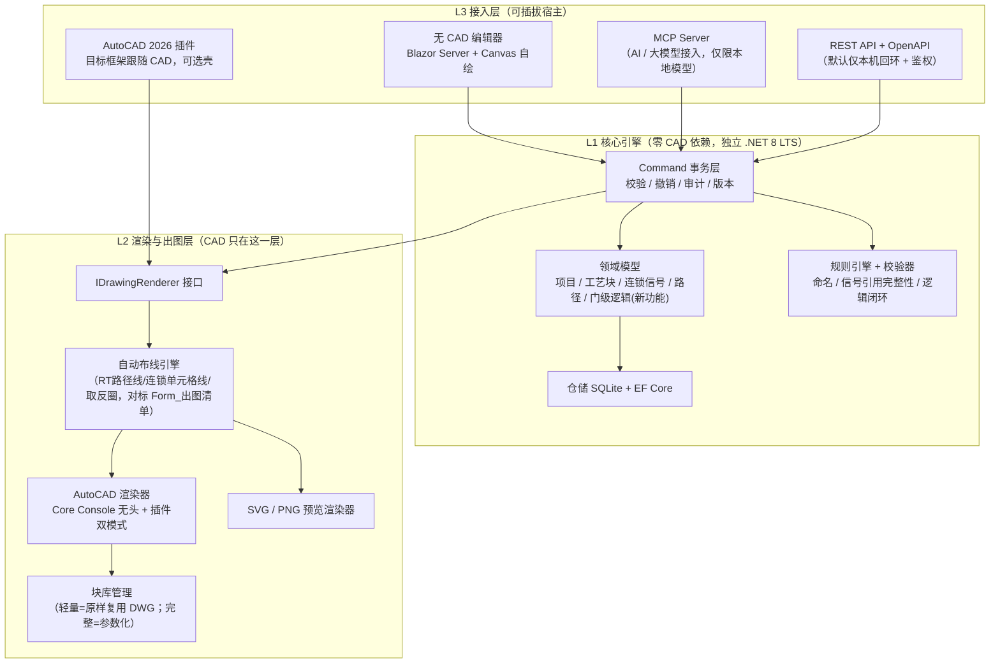

# BID2015 重构计划书 V2.0

| 项 | 内容 |
|---|---|
| 文档版本 | V2.0 |
| 日期 | 2026-10-16 |
| 对象系统 | BID2015（水泥厂仪表/控制逻辑图、联锁图 AutoCAD 绘图工具） |
| 状态 | **评审意见已吸收，待立项评审** |
| 与 V1 的关系 | 依据红队评审意见书（`BID2015_重构计划_V1_评审意见.md`）修订；每条改动见附录 A 评审意见核销表 |
| 素材来源 | `BID_Debug.rar` 解包 + 反编译源码逐行核对 + 配置文件；全部结论附文件/行号 |

## 修订记录

| 版本 | 日期 | 说明 |
|---|---|---|
| V1.0 | 2026-10-16 | 初版。基于反编译分析形成架构设计与实施计划 |
| V2.0 | 2026-10-16 | 红队评审修订。重写现状基线（死代码链澄清、活数据模型、连锁语义表）；修正 C8/C9 定性错误与无来源数字；.NET 版本解绑；新增 MVP 分层成功标准、U2 失败决策树；迁移映射表按活数据重写；任务树补自动布线/DWG比对/属性编辑器/打印管线四项；AI 工具集补 diff/信号校验/批量导出；涉密红线扩展；验收判据可操作化。核销表见附录 A |

---

# 1. 目的与范围

## 1.1 目的

把现有 BID2015 从"必须绑定 AutoCAD 2015 + VB.NET + XML 文件"的单机工具，重构为：

1. **核心引擎与 CAD 彻底解耦**，可在无 CAD 环境下运行；
2. **出图环节支持新版 AutoCAD**（2026），并支持无头批处理；
3. **预留标准 AI 操作接口**，使大模型可以读项目、改项目、触发校验与出图；
4. 输出物仍为符合企业标准的 **CAD 版（DWG）图纸**，保证施工/调试可用。

## 1.2 分层成功标准（MVP）

重构按三层交付，每层可独立验收、独立产生价值。任何一层受阻不影响已交付层（V1 缺失此分层，评审意见 G4）：

| 层 | 内容 | 独立价值 | 退出条件 |
|---|---|---|---|
| **MVP1 保底** | 用 AutoCAD 2026 .NET API 重写 LineJig（BIDLL/BIDPL/BIDTRIM）+ 绘图工具壳 | 在新 CAD 上恢复绘图工具，消除"旧工具不可用"的燃眉之急 | 在 2026 上插块/画线/属性编辑全流程可用 |
| **MVP2 核心** | 新领域模型 + XML 导入 + 无头批量出图（Core Console） | 历史项目可迁移，批量出图不需开 CAD | 3 个历史项目双跑通过 |
| **MVP3 智能** | MCP AI 接口 + 无 CAD 编辑器 | AI 读改项目、跨工具协作 | AI 全流程演示 + 审计闭环 |

**为什么不只做 MVP1（评审 §4.1 的回答）：** MVP1 只解决"能不能用"，不解决数据散、无校验、无 AI 通道的问题；且 MVP1 是 MVP2 的插件壳复用部分，增量成本不是全量。但若预算/时间中断，MVP1 单独交付即可保底。

## 1.3 范围

**在范围内：** 领域模型重建、数据层重建、规则与校验、AI 接口、渲染/出图层（含自动布线引擎重写）、交互层、历史项目迁移、验收。

**不在范围内（明确不做）：**
- 云端 SaaS 化、多人在线协同编辑（架构预留，不实现）；
- 对接 DCS/PLC 组态软件的信号自动导入（接口预留，不实现）；
- 三维/厂区布置图（本系统只出逻辑图与联锁图）；
- 门级联锁编辑器按旧"5门×4输入"设计复刻——该设计在旧系统中从未启用（见 §2.5），新系统的门级逻辑按 §6.2 新功能设计，不承担存量迁移。

---

# 2. 背景资料（现状基线）

> 本章结论来自对 `BID_Debug.rar` 的解包与反编译，并经 V2 评审逐行核实（评审意见书 §1）。证据以「文件:行号」标注。

## 2.1 系统构成（V2 补全）

| 组成 | 说明 | 来源 |
|---|---|---|
| `BID2015.exe` | 主程序，VB.NET WinForms，.NET Framework 4.0 / x86，ClickOnce 部署 | `BID2015.application`、`BID2015.xml` |
| `Main.cs` | 主窗体（79KB），项目与整体流程入口 | 反编译源码 |
| `BID属性编辑器.cs` | 块属性编辑窗体（127KB，**最大业务文件**）：双击 CAD 块弹出，编辑 43 个属性位并回写 CAD；是"块属性↔数据"的同步中心 | `BID属性编辑器.cs:3013-3539` |
| `Form_出图清单.cs` | 自动出图引擎（189KB）：插入图框/设备块/RT路径块/连锁单元格，**按数据自动布线**，人工仅指定出图位置 | `Form_出图清单.cs:2841,2898-2904,3641-3717` |
| `Form_交叉索引.cs` | 块引用交叉索引（全图/框选） | `Form_交叉索引.cs:402-466` |
| `LineJig.dll` | CAD 端自定义命令：**BIDLL**（参数化画逻辑线，含取反开关）、**BIDPL**（交互二折线）、**BIDTRIM**（修剪）——三个命令，V1 漏了 BIDTRIM | `LineJig\Command.cs:17,949,1274` |
| `DWG_PRINT2015.exe` | 外部打印程序：打印机/份数/框选打印的手动批量打印工具 | `DWG_PRINT2015\Form1.cs`；`PublicModule.cs:37` |
| `DotNetARX.dll` | 第三方 AutoCAD .NET 辅助库，非本项目代码 | 反编译产物 |
| `templet/` | 图块库：标准图块 18 个 DWG、典型设备 39 个文件（30+ DWG）、图框 4 个 | 解包清单 |
| `DB/config.xml` | 设备类型 → 输出标签模板，18 种设备类型 | `DB/config.xml:1-118` |

**V2 澄清（评审 B6）：** V1 基线未覆盖的三个最大业务文件（BID属性编辑器、Form_出图清单、Main）恰好包含数据模型与出图流程的最终真相，V2 已补齐。`Form连锁图.cs` 是无业务逻辑的设计器空壳（按钮未挂事件，标题仍为 Form1，`Form连锁图.cs:280-408`）。

## 2.2 关键事实数字（V2 修正标注）

| 项 | 值 | 来源 | V2 备注 |
|---|---|---|---|
| 图纸尺寸 | 42000 × 29700（A3，按 ×100 绘图单位） | `PublicModule.cs:45-47` | |
| 图纸排布间隔 | X=50400，Y=44550；单行 10 张 | `PublicModule.cs:49-53` | 仅为常量，**实际出图位置由人工点选**（`Form_出图清单.cs:2841`），无头化需参数化排布 |
| 逻辑线图层 | `Logic_connect`，青色 | `PublicModule.cs:55,457-458` | |
| 标准字体 | `SINOMA(NJ)` | `PublicModule.cs:57` | |
| 图框文件 | `Sinoma_Frame_A3ENG.dwg`；图名/图号/总页经 `<GN><PG><PT>` 模板替换自动填充 | `PublicModule.cs:33`；`Form_出图清单.cs:3631-3633` | V2 补图框属性自动填充事实 |
| BID 块属性位 | **43 个**（位 0–42） | `CAD图块属性.cs:8-92` | V1 未标来源，V2 补：显示编号/序号/工艺编号/工艺名称/所属组号/组名/设备类型/路径×8/路径名称×8/正向×8/九连锁位/注释×3。另有 InputList(5位)/OutputList(4位)/RT1(16位)/RT2(26位)/图框(3位) 独立属性位定义（`CAD图块属性.cs:94-198`） |
| 逻辑门常量 | 门数 5、每门输入 4、总量 20 | `PublicModule.cs:39-43` | **V2 澄清：这三个常量全工程无引用，属死代码**（见 §2.5 死代码链），是历史设计意图，不是在用功能 |
| 业务模块数 | 21 个业务源码文件，其中 Form 子类 14 个（含 Main、BID属性编辑器） | 源码清单 | V1 计数 12 已修正 |

## 2.3 设备类型与输出标签模板（18 种，抽查属实）

`<$>` 为工艺编号通配符。V1 §2.3 的表格与 `DB/config.xml:1-118` 核对一致，保留：

| 设备类型 | 输出标签模板 | 单驱动 |
|---|---|---|
| Group组 | `<$>_GSTR;<$>_GSTP;<$>_GRUN` | 是 |
| 单向电机【含速度】 | `<$>_RUN` | 是 |
| 双向电机【含速度】 | `<$>_CRUN;<$>_ARUN` | — |
| 单驱动气动阀电磁阀 | `<$>_OPEN;<$>_CLOSE` | 是 |
| 执行器 | `<$>_MAX;<$>_MIN;<$>_POS` | — |
| 电动三通阀 | `<$>_POS1;<$>_POS2` | — |
| 模拟三通阀 | `<$>_POS1;<$>_POS2;<$>_POS` | — |

## 2.4 CAD 耦合点清单（V2 修正 C8/C9）

| 编号 | 耦合点 | 代码位置 | 性质 |
|---|---|---|---|
| C1 | `Interaction.GetObject(null, "AutoCAD.Application")` 接管运行中的 CAD | `PublicModule.cs:117-127` | 进程级强绑定 |
| C2 | `SendCommand` 拼 `(command "NETLOAD" .../LineJig.dll)` | `PublicModule.cs:139` | 字符串命令，脆弱 |
| C3 | `SendCommand` 发 `BIDLL` 画逻辑线（起点/终点/取反参数化） | `PublicModule.cs:452-473` | 字符串命令 |
| C4 | `ModelSpace.InsertBlock(...与门001.dwg 等)` | `Form_绘图工具.cs:900,919,938,957,985` | 外部块文件依赖 |
| C5 | `SelectionSets.SelectOnScreen / Select`，DXF 组码过滤 `0=INSERT`、`2=块名`、`66=属性标志` | `PublicModule.cs:195-324` | 屏幕交互 |
| C6 | `GetBoundingBox` + `WholeIn` 判断块归属哪个图框 | `PublicModule.cs:326-377` | 几何计算 |
| C7 | `AcadAttributeReference` 读写 `TagString/TextString/ScaleFactor`，按 Tag 中 `:长度` 自动缩字号 | `PublicModule.cs:392-450` | 属性驱动 |
| **C8（V2 重写）** | ~~XData 扩展数据回写~~ → **块属性 TagString/TextString 是唯一数据回写通道**（`SAVE_BlockAttribute` 直接写回 CAD；43 属性位是数据投影）。V1 所称 XData 读写经核实为反编译空壳方法，全工程零业务调用 | `BID属性编辑器.cs:3024`；`Class_BID块.cs:766-880`（空方法） | 属性驱动 |
| **C9（V2 重写）** | ~~领域类继承 COM 对象~~ → `Class_BID块 : AcadBlockReference` 是**死代码**（零 New/零引用），领域模型实际未被 COM 污染；真正的风险是**属性编辑业务规则（127KB）集中在单个窗体文件**，无模型层 | `Class_BID块.cs:9`；grep 全工程仅 2 处自引用 | 待重构的业务规则聚集地 |
| C10 | `CAD句柄`（Handle）作为图纸↔数据关联键 | `项目DataSet.cs:125` | 双向绑定 |
| C11 | 隐藏全部窗口 + `AppActivate` 把屏幕让给 CAD | `PublicModule.cs:169-193,379-390` | 交互 hack |

## 2.5 数据模型（V2 重写：活数据 + 死代码链澄清）

### 2.5.1 活数据（真正要迁移的全部内容）

**（1）`项目DataSet.DT流程块`** —— 主表（`项目DataSet.cs:39-125`）：

- 标识：显示编号 / 序号 / 工艺编号 / 工艺名称 / 所属组号 / 所属组名 / 设备类型（7 列）
- 路径：`路径选择1..8` / `路径名称1..8` / `路径1..8正向运行`（24 列，固定 8 路径）
- **连锁输入 9 列**（`项目DataSet.cs:101-117`，语义按 `BID属性编辑器.cs:3323-3379` 按钮命名破译）：

| 列 | 语义（V2 补） | 值格式 |
|---|---|---|
| `STL1_IN`、`STL2_IN` | **起动连锁**输入 1、2 | 分号分隔信号名列表（见下） |
| `OPL1_IN`、`OPL2_IN` | **操作连锁**输入 1、2 | 同上 |
| `PRL1_IN`、`PRL2_IN` | **保护连锁**输入 1、2 | 同上 |
| `STR1_IN`、`STR2_IN` | **组起条件**输入 1、2 | 同上 |
| `STP_IN` | **组停条件**输入 | 同上 |

- 备用字段 ×3、`CAD句柄`

**关键格式事实（V2 补，评审 B1）**：连锁列的值是**分号分隔的信号名列表**（如 `C-101_RUN;X-205_OPEN`），出图时 `Split(';')` 拆分逐信号连线到连锁单元格块（`Form_出图清单.cs:3648-3653`）。**存量数据没有门级结构**（门类型/延时/管脚号），图纸上的与门/或门块是人工插入的图形符号，其输入无数据层联锁语义。

**（2）`设置DataSet.DT设备类型`** —— 18 种设备类型 + 输出标签模板 + 单驱动标志（`DB/config.xml:1-118`）。

**（3）图纸侧数据投影** —— BID 块 43 属性位 = DT流程块 大部分字段的 CAD 块属性投影（`CAD图块属性.cs:8-92`）；图框 3 属性位（图名/图号/总页）；RT1/RT2 属性位（RT 路径块 16/26 位）。

### 2.5.2 死代码链（V1 误当活代码，V2 澄清）

以下模块**全工程零业务引用**，是"门级联锁编辑器"的未完成/未启用历史设计，**不存在存量数据，不参与迁移**（评审 E3，U5 就此关闭）：

| 死模块 | 体量 | 证据 |
|---|---|---|
| `DataSet1.cs`（含 临时操作连锁1/11/12 三张 5门×4输入平铺表，即 V1 所称"80+ 列"） | 425KB（多为生成代码） | grep "临时操作连锁"仅命中自身；`new DataSet1()` 仅生成代码内部 |
| `Form逻辑图.cs`（5门×4输入+ON/OFF延时+NOT+管脚 编辑窗体） | 117KB | grep "Form逻辑图"仅 3 处自引用 |
| `Class逻辑.cs`（STL/OPL/PRL 三组×5门×4输入 运行时载体，含管脚字段） | 7KB | 仅被 Form逻辑图 使用，连带死 |
| `Form连锁图.cs`（设计器空壳） | 10KB | `Form连锁图.cs:280-408` 按钮未挂事件 |
| `Class_BID块.cs` | 24KB | 零 New/零引用 |

**含义**：新系统若做门级逻辑编辑（§6.2 `gates`），定位是**全新功能**；V1 §8.2 中"80+ 列平铺塌缩为两层模型"的迁移映射作废——没有任何项目 XML 含这些列。

### 2.5.3 出图流程事实（V2 新增，评审 B2/B3/B4）

旧系统的出图清单**本身就是"数据→自动布线→DWG"引擎**，这是新系统渲染层的直接对标物：

| 环节 | 事实 | 证据 |
|---|---|---|
| 出图位置 | 人工 `GetPoint` 点选（"鼠标在图面上指定出图位置"） | `Form_出图清单.cs:2841` |
| 图框 | 自动插入 Sinoma_Frame_A3ENG.dwg，图名/图号/总页按 `<GN><PG><PT>` 模板替换填充 | `Form_出图清单.cs:2898,3631-3633` |
| 设备块 | 按 DT流程块 数据插入 + 43 属性位填充 + 按属性长度自动缩字号 | `Form_出图清单.cs:2904`；`PublicModule.cs:392-450` |
| RT 路径线 | **自动画**：RT 路径块插入点 → 目标块属性对齐点，17 处调用 | `Form_出图清单.cs:3149-3422` |
| 连锁单元格线 | **自动画**：信号列表拆分 → 逐个写入连锁单元格块属性 → 从单元格画线到逻辑门坐标，支持取反标志（Y/N） | `Form_出图清单.cs:3641-3717` |
| 人工修线 | BIDPL（二折线）/ BIDTRIM（修剪），修整后的几何**只存在于 DWG，不在数据层** | `LineJig\Command.cs:949,1274` |

**对迁移的推论：旧项目迁移不需要从旧 DWG 提取线的几何**——数据（信号列表）在即可按规则重画；代价是**人工修过的线（BIDPL/BIDTRIM 产物）重画后不保留**，此影响须写入迁移报告并向用户明示（评审 G5）。

## 2.6 部署与硬约束

- 必须先打开 AutoCAD 才能使用；未打开则 MsgBox 报错并中止（`PublicModule.cs:107,128,135,146`）
- 原配 AutoCAD 2015（.NET 4.0 / x86 / COM PIA）
- 本机现装 AutoCAD 2026（注册表 R25.1，用户环境记录 2026-09-18 实测）
- **紧迫性前提（V2 补，评审 A4）**：旧程序集（x86 / .NET 4.0）在 2026（x64 / .NET 8）上 NETLOAD 大概率失败——**此为推断，需实测确认**；实测结论直接决定 MVP1 的优先级
- 字体、图框、图层名均为企业标准硬编码

## 2.7 已知代码质量缺陷（核对属实，保留 V1 清单）

| # | 问题 | 位置 | 风险 |
|---|---|---|---|
| Q1 | `Func_画逻辑线` 第二重载用 `double` 直接拼坐标，无 `"0.0"` 格式化（第一重载有） | `PublicModule.cs:460 vs 472` | 科学计数法/小数点致 CAD 命令解析失败 |
| Q2 | 全部 CAD 命令靠字符串拼接，源码自承"CAD 有执行未结束的操作命令"时会失败 | `PublicModule.cs:146` | 稳定性差 |
| Q3 | `Glob_隐藏窗口List` 显示窗口时 `Add` 而非忽略，列表累积逻辑错误 | `PublicModule.cs:184-193` | 内存与逻辑错误 |
| Q4 | 大量 `On Error Resume Next` 风格 try/catch 吞异常，仅弹框 | 全模块 | 故障难定位 |

---

# 3. 重构目标 → 设计对策

| 诉求 | 设计对策 | 落点 | V2 变更 |
|---|---|---|---|
| 融合最新技术 | .NET 8 LTS（核心层独立选型）+ EF Core + SQLite + MCP + Blazor | 全栈 | **G2：核心层与 CAD 层版本解绑**（见 §5） |
| 预留 AI 操作接口 | Command 事务层 + MCP Server + 项目 JSON Schema；AI 与人走同一入口 | 核心引擎 | 补读/审工具闭环（§6.3） |
| 在最新版 CAD 运行 | 以 AutoCAD 2026 .NET API 重写插件，弃用 COM/PIA | 出图层 | 目标框架跟随 Autodesk 要求（U1 降级为出图层风险） |
| 离开 CAD 运行、最后输出 CAD 版 | 核心零 CAD 依赖；出图走 Core Console 无头执行 | 核心 + 出图层 | U2 失败决策树（§7） |
| 保持图纸企业标准 | 图框/字体/图层/属性位参数化，纳入版本管理 | 渲染层 | 补自动布线规则参数化 |

---

# 4. 新架构

## 4.1 架构图（保留 V1）



V2 变更：渲染层新增**自动布线引擎**节点（评审 B2/G6——这是旧系统出图的核心机制、新系统渲染层此前缺失的最大工作项）；AI 通道标注涉密约束。

## 4.2 设计原则

1. **领域模型不继承任何 CAD 类型，属性编辑规则从窗体代码中析出**。`工艺块`/`连锁`/`信号` 为纯 POCO；`CAD句柄` 降级为渲染产物元数据。（V1 原则 1 引用的 C9 经核实为死代码，原则本身仍成立）
2. **所有写操作（人 / AI / 批量导入）必须经过 Command 层**。AI 安全与企业审计的地基，没有例外路径。
3. **渲染接口唯一**。UI 预览与 CAD 出图共用同一份中性「图面描述」（Drawing Script），Drawing Script 必须包含**连线实体**（信号→图元的布线指令），保证"屏上所见 = DWG 所得"。
4. **旧数据只进不出**。历史 XML 通过导入器进入新模型；新系统不再产出 XML 数据文件。
5. **企业标准集中管控**。图框、字体、图层、属性位、命名规则、**布线规则**全部参数化并纳入版本库。

## 4.3 Solution 结构（V2 补一处）

```
BID.Core/                    # 领域模型 + 规则 + Command 层（零 CAD 引用，net8.0）
BID.Data/                    # EF Core + SQLite + 迁移 + 旧 XML 导入器
BID.Rendering/               # IDrawingRenderer + Drawing Script(含连线) + 布线引擎 + SVG 渲染
BID.Rendering.AutoCAD/       # AutoCAD 2026 渲染器（目标框架跟随 Autodesk 官方要求）
BID.Headless/                # Core Console 入口（无头出图 CLI）
BID.Plugin/                  # AutoCAD 插件壳（BIDLL/BIDPL/BIDTRIM 等价命令）
BID.Compare/                 # DWG 自动比对工具（验收前置，评审 G6/G9）
BID.Api/                     # ASP.NET Core Minimal API + OpenAPI（默认回环+鉴权）
BID.Mcp/                     # MCP Server（stdio 为主；仅限本地模型）
BID.Web/                     # Blazor Server 前端
BID.Tests/                   # 核心规则单测（不依赖 CAD，可进 CI）
```

---

# 5. 技术选型

| 层 | 选型 | 理由 | V2 变更 |
|---|---|---|---|
| 核心引擎 | **C# / .NET 8 LTS（独立选型）** | 零 CAD 依赖的层不受 AutoCAD 制约，选 LTS 稳定 3 年；AI 生成 C# 质量显著高于 VB | **G2：与出图层解绑**。V1"统一目标框架最省事"的方案在全栈复用上有便利，但把 U1 变成全栈风险，不值 |
| 出图层 | C#，目标框架**以 Autodesk 官方要求为准**（U1 查证后锁定） | AutoCAD 2026 .NET API 的目标框架由 Autodesk 决定，不由本计划决定 | U1 影响范围从"全栈"降为"仅 BID.Rendering.AutoCAD + BID.Plugin" |
| 数据 | SQLite + EF Core | 单文件、免服务、易备份；仓储抽象可换 PostgreSQL | |
| AI 协议 | MCP（本地 stdio）为主 + REST 为辅 | 本机已有 MCP 基建；REST 供其他工具接入 | G8：REST 默认仅回环+鉴权；文档明示 AI 接口仅限本地模型 |
| 无 CAD 预览 | 自绘 Canvas / SVG（含布线） | 逻辑图=块+线+属性 | |
| 无头出图 | AutoCAD Core Console | CAD 内核出图兼容性 100%；可批处理 | **需实测（U2），失败决策树见 §7.3** |
| 备选出图 | ODA（商业）/ ACadSharp（开源） | 能力待 spike | |
| 前端 | Blazor Server（备选 WinForms） | 决策点 D2 | |

**为什么不延续 VB.NET：** 新版 CAD .NET API 生态以 C# 为主；"AI 能改这个软件"直接依赖 AI 代码生成质量。VB 反编译产物保留作业务对照。

**资源模型声明（V2 补，评审 A5/G10）：** 本项目按"用户 + AI 结对"开发模式估算工作量，人周数为**有效验证工时口径**（AI 产出快、人工验证慢，瓶颈在验证）：AI 辅助可显著压缩编码项，但 spike、双跑比对、图纸评审等验证项基本不可压缩。工作量数字仍为粗估量级，立项前需按 §9 WBS 细化。

---

# 6. AI 接口设计

## 6.1 设计定位

AI 接口是核心引擎的正规入口层，不是外挂。AI 与人走同一 Command 事务层，天然获得校验、撤销、审计。

## 6.2 项目文档格式（V2 修正：连锁模型对齐活数据）

```json
{
  "project": { "id": "P-2026-014", "name": "××水泥线烧成系统", "rev": 3 },
  "devices": [{
    "tag": "C-101",
    "deviceType": "单向电机【含速度】",
    "outputs": ["C-101_RUN"],
    "group": "G-01",
    "interlocks": {
      "start":       [ { "signal": "C-101_RUN", "invert": false } ],
      "operate":     [ { "signal": "X-205_OPEN", "invert": true } ],
      "protect":     [],
      "groupStart":  [],
      "groupStop":   []
    },
    "gates": [
      { "type": "AND", "inputs": [
          { "signal": "C-101_RUN", "onDelay": 2, "invert": false },
          { "signal": "X-205_OPEN", "onDelay": 0, "invert": true }
      ]}
    ],
    "paths": { "selection": [1, 2], "names": ["主线", "旁路"] }
  }],
  "sheets": [{ "name": "连锁图-01", "devices": ["C-101", "X-205"] }]
}
```

V2 变更：
- `interlocks` 五组对应活数据语义（start=STL 起动 / operate=OPL 操作 / protect=PRL 保护 / groupStart=STR 组起 / groupStop=STP 组停），存量迁移的承接点；
- `gates` 为**新功能**（门级逻辑，旧系统未启用，见 §2.5.2），初期可空；
- `outputs` 由设备类型模板自动展开（§2.3），AI 不必手填。

## 6.3 工具集（V2 补三个读/审工具）

| 工具 | 作用 | 安全等级 |
|---|---|---|
| `project.open / save / list` | 项目读写 | 读 / 写 |
| `device.create / update / delete` | 工艺块增删改 | 写（过校验） |
| `interlock.set` | 设置某设备某类连锁的信号列表 | 写 |
| `gate.setLogic` | 设置门类型与输入（与/或/非/异或/RS/SR/PID，新功能） | 写 |
| `rules.validate` | 运行全部校验，返回问题清单 | 只读 |
| **`signal.resolve`（V2 补）** | 信号引用完整性校验：拼写"合法但设备不存在"的拦截（如 `C101_RUN`） | 只读 |
| **`project.diff`（V2 补）** | 两次保存之间的变更清单，供人快速复核 AI 改动 | 只读 |
| **`interlocks.dump`（V2 补）** | 按设备/按图批量导出连锁数据 | 只读 |
| `project.explain` | 把某设备/某联锁翻译成人话 | 只读 |
| `drawing.generate` | 触发出图（Core Console 或插件） | 写（重操作） |
| `template.list` | 列出可用块模板与设备类型 | 只读 |
| `migration.importXml` | 导入旧版 XML 项目 | 写 |

## 6.4 硬规矩

1. AI 写操作必须走 Command 层，禁止直连数据库。
2. AI 不直接写 DWG，只能改项目模型；出图统一走渲染层。
3. 重操作（出图 / 打印）默认 dry-run，需人工确认开关才执行。
4. **（V2 补）`signal.resolve` 未通过的写操作拒绝提交**——阻断"拼写合法但引用悬空"的静默错误（评审叙事三）。
5. **（V2 补）涉密红线：AI 接口仅限本地模型 / 本地 MCP**。任何把项目数据发送云端大模型的行为与本系统涉密要求冲突，写入架构决策记录与使用规范；REST 默认仅本机回环且强制鉴权。

---

# 7. 出图方案

## 7.1 方案对比（保留 V1 结论）

| 方案 | 原理 | 结论 |
|---|---|---|
| A. Core Console | accoreconsole 无头跑 net 程序集 | **首选**，待 U2 实测 |
| B. CAD 插件（双宿主） | 同一渲染 DLL 在 CAD 内加载 | 与 A 并存；**MVP1 即此形态的保底** |
| C. 纯托管写 DWG | ACadSharp / ezdxf | 仅 spike，V1/V2 均不做 |

**涉密约束：** 不使用 Autodesk 云 API（AutoCAD I/O）——数据会离开内网；AI 云通道同等禁止（§6.4）。

## 7.2 与 V1 的差异说明

V1 已正确识别出图是"最重"的层，但漏了**自动布线引擎**（B2）——旧系统按数据自动画 RT 路径线与连锁单元格线，新系统渲染层必须等价重写该规则（含取反圈语义），Drawing Script 中连线是一级实体。工作量并入 L4（见 §9）。

## 7.3 U2 失败决策树（V2 新增，评审 G3）

```
L1 spike（2 周门禁）实测 Core Console 加载 net DLL 全流程
├─ 通过 → 按计划走 A+B 双模式
├─ 部分通过（能画图不能打印等）→ A 降级为"生成 DWG + 插件内打印"，范围声明调整
└─ 失败 → 触发保底分支：
    ① MVP1（2026 插件 + 人工出图）升为交付主体
    ② 项目范围声明降级："无 CAD 运行"目标推迟到 AutoCAD 2027 或 ODA 授权到位
    ③ 不重试同一技术路线超过 2 周（防沼泽）
```

---

# 8. 数据模型与迁移

## 8.1 新模型（V2 调整）

`Project` / `Device` / `InterlockSignal`（连锁信号子表：deviceId + 类别5种 + 信号引用 + 备注） / `Gate` + `GateInput`（**新功能承载，初期可空**） / `Signal` / `Path` / `Sheet` / `BlockTemplate` / `DeviceType` / `DrawingRevision` / `AuditLog`

## 8.2 迁移映射（V2 按活数据重写，评审 G5）

| 旧结构 | 新结构 | 说明 |
|---|---|---|
| `DT流程块` 标识 7 列 | `Device` 主属性 | 直接映射 |
| `DT流程块.路径选择/名称/正向 1..8` | `Device 1—N Path` 子表 | 消灭固定 8 列窄表 |
| `DT流程块.STL1/2、OPL1/2、PRL1/2、STR1/2、STP` 共 9 列 | `InterlockSignal` 子表：**分号拆分信号列表**，类别=起动/操作/保护/组起/组停 | V1"80+列平铺→两层"映射**作废**（旧结构是死代码，无存量） |
| `CAD句柄` | `Device.cadHandle`（可空，渲染回填） | 降级为元数据 |
| `DB/config.xml` 18 设备类型 | `DeviceType` 表 | 入库版本化 |
| BID 块 43 属性位 / 图框 3 位 / RT1、RT2 属性位 | 渲染映射配置（块模板属性位↔领域字段） | 出图投影的参数化依据（`CAD图块属性.cs`） |
| 图纸上的线（DWG 几何） | **不迁移**——由新布线引擎按数据重画 | 人工修线（BIDPL/BIDTRIM）不保留，写入迁移报告向用户明示 |

## 8.3 迁移与验收约束（V2 可操作化，评审 G9）

- 导入必须逐字段可追溯，无法映射的字段不得静默丢弃，产出迁移报告。
- 首批 3 个真实历史项目，**选样标准**：至少覆盖 单驱动设备、双驱动设备、Group 组逻辑、RT 路径 各一次（评审 A6）。
- **双跑比对用自动比对工具**（`BID.Compare`，L6 前置交付）：几何比对（坐标容差内）+ 属性比对（文本全等）双通道。
- **"可解释差异"白名单**（白名单外差异=不通过）：人工修线痕迹（BIDPL/BIDTRIM 产物）、线宽/颜色微差、字体渲染微差、图纸环境变量差异。
- 通过判据：白名单外差异清零，白名单内差异逐条记录并经用户签字确认。

---

# 9. 实施计划（任务树）

> 编号规则：阶段.序号；〔轻量〕〔完整〕标注方案归属（评审 G6/F8）；MVP 分层见 §1.2。切 Agent 模式后按 `AI任务管理\任务树模板.md` 建可勾选树。

## L1 基线与验证（约 2–3 人周）

| 编号 | 任务 | 产出 | 完成判据 | V2 变更 |
|---|---|---|---|---|
| L1-1.1 | ~~补读未读模块~~ **V2：已完成**（评审基线已入 V2 §2） | — | — | 评审中完成，产出=`BID2015_重构计划_V1_评审意见.md` §1 |
| L1-1.2 | 技术 spike：Core Console 无头加载 → InsertBlock → 属性 → 画线 → 打印 PDF；同步 spike ACadSharp 写块/属性 | 验证报告 | U2/U3 有确定结论，**2 周门禁** | 画线纳入 spike（V1 漏） |
| L1-1.3 | 领域模型 Schema v0.1 + 旧 XML 字段映射表 | Schema + 映射表 | 覆盖 §8.2 全部映射（按活数据） | 基准换为 §2.5.1 |
| L1-1.4 | 查证 AutoCAD 2026 .NET API 目标框架（Autodesk 官方文档） | 结论记录 | U1 关闭（仅影响出图层） | |
| L1-1.5〔轻量〕 | 实测旧工具（x86/.NET4.0 程序集）在 2026 上的 NETLOAD 行为 | 实测记录 | A4 关闭：重构紧迫性论证有据 | V2 新增 |

## L2 核心引擎（约 6–8 人周，均属 MVP2）

| 编号 | 任务 | 产出 | V2 变更 |
|---|---|---|---|
| L2-2.1 | POCO 领域模型 + 规则引擎（连锁五类语义 + 信号引用完整性） | `BID.Core` | "5门×4输入"从既有业务改为新功能占位 |
| L2-2.2 | 校验器：命名规则、信号重复、输出标签一致性、**signal.resolve 引用完整性** | 规则集 + 单测 | V2 补引用完整性 |
| L2-2.3 | EF Core + SQLite 仓储 + 迁移 | `BID.Data` | |
| L2-2.4 | Command 事务层 + 撤销 + AuditLog（含 AI 客户端标识） | 事务内核 | |
| L2-2.5 | 旧 XML 导入器（9 连锁位分号拆分） | 迁移报告 | 按活数据开发 |

## L3 AI 接口（约 3–4 人周，属 MVP3）

| 编号 | 任务 | 产出 | V2 变更 |
|---|---|---|---|
| L3-3.1 | 项目 JSON Schema v1.0 定稿 | Schema + 示例 | 按 §6.2 V2 版 |
| L3-3.2 | MCP Server 工具集（§6.3 十二项） | `BID.Mcp` | 补 diff/resolve/dump |
| L3-3.3 | REST API + OpenAPI（回环+鉴权） | `BID.Api` | |
| L3-3.4 | `project.explain` 联锁→自然语言 | 解释器 | |

## L4 渲染与出图（约 10–14 人周，最重）

| 编号 | 任务 | 产出 | V2 变更 |
|---|---|---|---|
| L4-4.1 | `IDrawingRenderer` + Drawing Script（**含连线实体**） | 渲染抽象 | V2 明确连线为一级实体 |
| L4-4.2〔轻量〕 | SVG 预览渲染器 | 无 CAD 看图 | |
| L4-4.3 | **自动布线引擎**：RT 路径线 + 连锁单元格线 + 取反圈规则（对标 `Form_出图清单.cs:3149-3422,3641`）+ 出图位置参数化排布（替代人工 GetPoint） | 布线引擎 | **V2 新增，V1 完全缺失** |
| L4-4.4 | AutoCAD 渲染器（插件 + Core Console 双模式） | `BID.Rendering.AutoCAD` | |
| L4-4.5〔完整〕 | 参数化块库重构（18 标准块 + 30 典型设备 + 43 属性位 + InputList/OutputList/RT1/RT2/图框位） | 块库 + 元数据 | 属性位来源补齐 |
| L4-4.6〔轻量〕 | 打印管线（替代 DWG_PRINT2015：打印机/份数/批量） | 打印管线 | V2 显式列出 |
| L4-4.7 | **BID属性编辑器业务规则等比迁移**（43 属性位联动、`:长度` 字号缩放、设备类型联动） | 属性编辑模块 | **V2 新增，V1 漏（127KB 业务规则无处安放）** |

## L5 交互（约 4–6 人周，属 MVP3）

| 编号 | 任务 | 产出 |
|---|---|---|
| L5-5.1 | 无 CAD 编辑器（形态见 D2） | 编辑器 |
| L5-5.2 | 连锁/路径可视化编辑（拖拽连信号） | 编辑能力 |

## L6 验收（约 3–4 人周 + 比对工具前置）

| 编号 | 任务 | 完成判据 | V2 变更 |
|---|---|---|---|
| L6-6.1 | `BID.Compare` DWG 自动比对工具（几何容差 + 属性全等） | 工具可运行、差异报告自动产出 | **V2 新增为 L6 前置** |
| L6-6.2 | 3 个历史项目双跑自动比对 | 白名单外差异清零（§8.3） | 判据可操作化 |
| L6-6.3 | 图签/字体/图层/属性符合 Sinoma 标准人工评审 | 签字确认 | |
| L6-6.4 | 交接文档 + 培训 | 交付 | |

## 9.1 工作量粗估（仍为量级，立项前需 WBS 细化；资源口径见 §5）

| 方案 | 合计人周 | V2 变化 |
|---|---|---|
| 完整方案（含 L4-4.5 参数化块库） | 约 **30–41** | V1 的 26–38 + 布线引擎/比对工具/属性编辑迁移/打印管线 四项隐藏工作量（评审 §4.2） |
| 轻量方案（块库原样复用，L4 压缩） | 约 **24–29** | 同比例上浮 |

**轻量/完整边界（评审 F8）：** 轻量=跳过 L4-4.5（参数化块库），保留 L4-4.3（布线引擎）与 L4-4.7（属性编辑规则迁移）——这两项是出图正确性所系，不可裁。建议 V1 实施=轻量方案（D9），参数化块库留作下一期。

---

# 10. 风险与未验证假设（V2 更新）

| 编号 | 假设 / 风险 | 影响 | 状态 / 关闭方式 | V2 变更 |
|---|---|---|---|---|
| U1 | AutoCAD 2026 .NET API 目标框架 | **降级：仅影响出图层** | L1-1.4 查官方文档 | 影响范围缩小（G2） |
| U2 | Core Console 无头加载 net DLL 全流程（含画线、打印） | 最高，决定"离开 CAD" | L1-1.2 实测，**2 周门禁**，失败走 §7.3 决策树 | 有 Plan B |
| U3 | ACadSharp 写带属性块 | 中，逃生舱可行性 | L1-1.2 spike | |
| U4 | 43 属性位可参数化重建 | 中 | 出处已核实（`CAD图块属性.cs:8-92`），重建工作量 L4-4.5 | 已有据 |
| U5 | DataSet1 业务触发条件 | — | **已关闭：零业务触发，死代码**（评审 E3） | 关闭 |
| U6 | 典型设备 DWG 中 `@RT` 后缀版本差异 | 低 | 未查证，维持 | |
| U7 | Sinoma 图框、字体授权延续 | 中 | 需用户确认 | |
| U8 | 老用户接受新交互 | 中 | 决策点 D6 | |
| U9 | .NET SDK 安装 | 低 | 安装即可 | |
| **U10（V2 新增）** | 旧工具在 2026 是否彻底不可用 | 中，决定 MVP1 优先级 | L1-1.5 实测 | |
| **U11（V2 新增）** | AI 云模型通道造成涉密数据外泄 | 高，安全事故 | 制度+文档红线（§6.4），执行中监控 | |
| **U12（V2 新增）** | AI 改动语义错误绕过语法校验 | 中高 | signal.resolve + 抽检制度（M4） | |

---

# 11. 评审决策点

| ID | 决策 | 选项 | 本文建议 | V2 变更 |
|---|---|---|---|---|
| D1 | 语言 | C# 全栈 / 核心 C#+壳 | C#；**核心与出图层可异框架** | |
| D2 | UI 形态 | Blazor / WinForms | Blazor，尊重学习成本可退 | |
| D3 | 存储 | SQLite / PostgreSQL | SQLite 起步 | |
| D4 | 出图路线 | A / B / C | A 为主 + B 并存；**U2 失败走 §7.3** | 增决策树 |
| D5 | AI 接入 | MCP / REST | MCP 主 + REST 辅（回环） | |
| D6 | 接管已打开 CAD | 保留 / 无头 | 插件模式保留，非默认 | |
| D7 | 迁移策略 | 双跑 / 直切 | 双跑；**判据=§8.3 白名单** | 可操作化 |
| D8 | 命名 | 中文 / 英文+中文注释 | 后者 | |
| D9 | V1 是否含参数化块库 | 含 / 不含 | **不含（轻量方案），但布线引擎+属性编辑迁移不可裁** | 边界澄清 |
| **D10（V2 新增）** | MVP 分层交付 | 全量 / 分层 | 分层（§1.2）：MVP1 插件保底 → MVP2 核心无头 → MVP3 AI | 新增 |
| **D11（V2 新增）** | AI 模型边界 | 本地模型 / 允许云模型 | **仅限本地模型**（涉密红线） | 新增 |

**建议立项评审聚焦三项：D4（出图路线）、D9（轻量边界）、D10（MVP 分层）。** 其余八项 V1/V2 建议已无实质分歧。

---

# 12. 附录

## 12.1 评审意见核销表（V2 对评审意见书的逐条响应）

| 评审发现 | 级别 | V2 处理 | 位置 |
|---|---|---|---|
| E1 C8 XData 定性错误 | 必须处理 | 已重写为"块属性是唯一回写通道" | §2.4 C8 |
| E2 C9 死代码误判 | 必须处理 | 已重写；风险改述为"业务规则聚集窗体" | §2.4 C9 |
| E3 DataSet1/临时操作连锁1 死代码 | 必须处理 | §2.5.2 澄清；U5 关闭；映射表重写 | §2.5.2, §8.2, §10 |
| E4 连锁语义未解释 | 必须处理 | 语义表（起动/操作/保护/组起/组停） | §2.5.1 |
| E5 LineJig 漏 BIDTRIM | 必须处理 | 补三命令 | §2.1 |
| E6 43属性位无来源、门类型漏 SR | 必须处理 | 补出处；门类型含 SR | §2.2, §6.3 |
| E7 Form 计数误差 | 必须处理 | 修正 14 个 | §2.2 |
| B1 分号列表数据形态 | 必须处理 | 写入基线与映射 | §2.5.1, §8.2 |
| B2 自动布线引擎事实 | 必须处理 | 新增 L4-4.3；架构图补节点 | §2.5.3, §4.1, §9 |
| B3 出图位置人工点选 | 必须处理 | 布线引擎含参数化排布 | §2.5.3, L4-4.3 |
| B4 图框模板填充 | 必须处理 | 写入基线 | §2.5.3 |
| B5 门级联锁未启用 | 必须处理 | gates 定位为新功能；不做存量迁移承诺 | §1.3, §2.5.2, §6.2 |
| B6 基线覆盖 40% | 必须处理 | V2 §2 补三模块定性；L1-1.1 标记已完成 | §2.1 |
| A3/F5 .NET 8 全栈绑定 | 必须处理 | 核心层独立选型 | §5, §10 U1 |
| A4/U10 旧工具是否已坏 | 必须处理 | L1-1.5 实测 | §2.6, §10 |
| A5 资源模型 | 必须处理 | 声明+口径 | §5 |
| A6 选样标准 | 必须处理 | §8.3 | §8.3 |
| F1 U2 无 PlanB | 必须处理 | §7.3 决策树 + 2 周门禁 | §7.3 |
| F2 迁移按死代码开发 | 必须处理 | 映射表重写 + L1→L2 门禁（M2） | §8.2 |
| F3 验收不可操作 | 必须处理 | BID.Compare + 白名单 | §8.3, L6 |
| F4 AI 缺读/审闭环 | 必须处理 | diff/resolve/dump 三工具 + 硬规矩4 | §6.3, §6.4 |
| F6 涉密 AI 云通道 | 必须处理 | 硬规矩5 + D11 | §6.4, §11 |
| F8 轻量边界模糊 | 必须处理 | 任务逐项标注〔轻量〕〔完整〕 | §9 |
| §4.1 缺最小替代方案 | 必须处理 | MVP 分层（MVP1 即答案） | §1.2 |
| §4.2 四大隐藏工作量 | 必须处理 | L4-4.3/4.6/4.7、L6-6.1 | §9 |

## 12.2 来源索引

| 类别 | 路径 |
|---|---|
| 计划书 V1 | `D:/BID_Debug/BID2015_重构计划_V1.md` |
| 红队评审意见书 | `D:/BID_Debug/BID2015_重构计划_V1_评审意见.md` |
| 解包产物 | `D:/BID_Debug/extracted/Debug/` |
| 反编译源码（C#） | `D:/BID_Debug/_rea/decompiled/{BID2015,LineJig,DWG_PRINT2015,DotNetARX}` |
| 反编译源码（VB 版） | `D:/BID_Debug/_rea/decompiled_vb/` |
| 逆向分析报告 | `D:/BID_Debug/_rea/REA_报告.md` |
| 设备类型配置 | `D:/BID_Debug/extracted/Debug/DB/config.xml` |
| 图块库 | `D:/BID_Debug/extracted/Debug/templet/` |
| 任务树 | `D:/BID_Debug/AI任务管理/BID2015计划书评审与V2/任务树.md` |

## 12.3 本计划书自身的边界

- 第 2 章事实经评审逐行核对（含 V1 未读的四个最大业务文件的关键段），但**未在运行的 AutoCAD 中验证过行为**；L1-1.5 实测项除外后置。
- U1/U2/U3/U10 在验证前不得当作确定结论使用。
- §9.1 工作量为粗估量级，非承诺工期；立项前按 WBS 细化。
