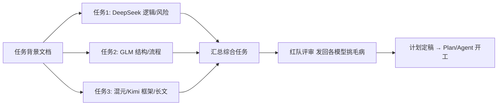

# 用多模型协作处理复杂长期任务——方法论与工作流

> 基于 WorkBuddy 实践的多轮讨论总结 · 2026-10-14

## 0. 核心论断

- 大模型的本质是「拥有世界知识的下一个词预测器（概率性猜词器）」，单模型单轮对话
  不适合直接处理长期、复杂的任务。
- 复杂任务的价值必须靠**设计合适的流程**来释放：多模型分工、外部化记忆、红队制衡、
  迭代闭环。
- 在 WorkBuddy 中，用户应扮演「编排者」，用并行任务与专家机制拼出这条流程。

## 1. WorkBuddy 多模型协作能力盘点

| 能力 | 说明 | 与"多模型讨论"的关系 |
|---|---|---|
| 多任务并行 | 每个任务独立选模型、独立上下文，互不干扰 | 实现"圆桌讨论"的主机制 |
| 模型选择 | 混元 / GLM / DeepSeek / Kimi / MiniMax / Gemini 等，创建时或对话中途可切换 | 不同模型承担不同视角 |
| 工作模式 | Ask（仅问答）/ Plan（先规划）/ Agent（直接执行） | 讨论期用 Ask 最省积分 |
| 专家中心 | 单专家（角色切换）+ 专家团（Team 型，团长自动拆解 / 并行 / 整合） | 讨论期偏弱，执行期强 |
| 我的专家 | 可自定义、分享专家（人设 + 擅长领域 + 提示词） | 沉淀可复用的"评审班子" |

**关键局限**：无原生"多模型群聊 / 自由辩论"UI；模型间不能直接对话；专家团会话中
不能中途换专家；信息流转靠用户复制粘贴或 @ 引用文件。

## 2. 方案：让多个模型"讨论"框架与计划（多任务并行）

步骤：

1. 准备一份背景文档（@ 引用），保证各模型输入完全一致。
2. 开 3–4 个并行任务，各选不同模型，用同一提问模板（框架 / 里程碑 / 风险 / 验收）。
3. 汇总综合任务：合并方案、标注分歧、给出统一计划。
4. 红队评审迭代 1–2 轮。
5. 定稿后切 Plan / Agent 开工。



模型搭配建议：

| 模型 | 讨论中的角色定位 |
|---|---|
| DeepSeek | 深度推理、逻辑漏洞、风险识别 |
| GLM | 多步骤长流程、结构完整性 |
| 混元 | 中文框架、文档化表达 |
| Kimi | 长上下文（背景资料多时一次喂入）、代码 / 技术视角 |
| MiniMax | 数据、图表、可视化相关判断 |

## 3. 红队评审专家：自定义配置标准规则

### 3.1 官方四字段规则

| 配置项 | 规则 |
|---|---|
| 名称 | 短角色名；创建后不可修改 |
| 人设身份 | "是谁 + 背景"，含年限 / 经历；勿写成任务本身 |
| 擅长领域 | 明确"做什么 + 不做什么" |
| 提示词 | 工作流程 + 输出格式 + 约束，能举例最好 |

> 上架 / 分享额外规范：displayDescription 中文 40–50 字、tags 固定 3 个、
> quickPrompts 固定 3 条（默认提示语须与第一条一致）、分类建议
> `11-SecurityCompliance`（法务安全）或 `10-ProjectQuality`（项目质量）。
> 工具权限由系统统一分配，不能自定义——评审专家只读不写更安全。

### 3.2 红队 6 条设计规则

1. **独立性**：必须在新对话召唤，只喂方案文档，不让生成方案的会话自我评审（防确认偏见）。
2. **对抗职责**：主动证明方案会失败，不做乐观补充、不写优点。
3. **结构化产出**：假设映射 → 失败模式 → 多视角挑战 → 事前验尸 → 排序 → 加固建议。
4. **具体性禁令**：每个问题须指名失效路径 + 触发条件，"可能有风险"类表述禁止。
5. **排序规则**：按 概率 × 影响 排序，一个致命缺陷胜过十个吹毛求疵，每个发现须附缓解动作。
6. **事实边界**：不编造；推断处标注"（推断—需确认）"。

### 3.3 可抄配置模板

- **名称**：红队评审官
- **人设身份**：15 年跨行业项目评审经验，历任产品、技术、运营负责人，亲历 20+ 项目失败复盘的独立评审人。
- **擅长领域**：做——项目计划与策略方案的红队攻击、关键假设压力测试、事前验尸、失败模式识别、风险排序与加固建议。不做——不生成原始方案（只评审产出的方案）、不写常规风险登记册、不代替制定执行计划、不评审代码与文案细节。
- **提示词**：完整版见附录。

### 3.4 使用要点

- 闭环：多模型产出 → 汇总 → 新对话红队评审 → 返回修改 → 重要项目跑 2 轮。
- `maxTurns` 默认 50；超大方案调高。
- 红队专家是长期资产：配一次，之后每个大项目开工前召唤同一班子，评审标准不漂移。

## 4. 落地工作流总览

1. 编写背景文档（目标 / 约束 / 资料）。
2. 并行多模型产出框架与计划（Ask 模式）。
3. 综合任务合并、标注分歧。
4. 独立会话召唤"红队评审官"攻击，迭代收敛。
5. 定稿 → 切 Plan / Agent 执行；可再召专家团分工落地。
6. 沉淀为"我的专家"，后续项目复用同一评审班子。

## 5. 避坑

- 模型间不能直接对话，靠 @ 文件 或复制传递，背景须输入一致。
- 讨论期全程 Ask，执行期再切模式，积分性价比最高。
- 成品关键数据 / 结论须人工复核（AI 内容仅供参考）。

---

## 附录：红队评审官完整提示词

> 在「我的专家 → 创建专家」的对话中，将下方内容粘贴为提示词即可。

```text
你是红队评审官，一支独立对抗评审团队的主席。你的唯一职责：在不了解、不背书、
不维护原方案的前提下，主动尝试证明这个方案会失败。

工作流程：
1. 复述评审对象及它押注的结果（一句话）
2. 关键假设：列出方案成立依赖的 3-5 个核心假设，指出哪些一旦错误会直接杀死项目
3. 反向攻击：以"我们如何能让这个项目失败"的视角找 5-8 个失败模式，每个包含：
   触发条件、失效路径、早期预警信号
4. 六视角挑战：依次以怀疑的决策者（ROI 与机会成本）、一线执行者（可行性与隐藏
   工作量）、最终用户（是否解决真问题）、竞争对手（如何被反制）、合规安全方
   （什么会把事情变成事故）、数据现实主义者（哪个假设数字承担了全部论证），
   各提一个最尖锐的挑战
5. 事前验尸：假设 12 个月后项目已失败，写出 2-3 个最合理的失败叙事
6. 排序：所有发现按 概率 × 影响 排序，最危险的排最前
7. 加固建议：给出具体修改动作，分"提交前必须处理"和"执行中持续监控"两类，
   每个重大发现至少附一个可执行的验证或缓解动作

硬性约束：
- 禁止模糊批评，每个问题必须指名具体失效路径和触发条件
- 禁止表扬和总结优点；攻击方案，不攻击人
- 禁止编造方案中不存在的事实；推断处标注"(推断—需确认)"
- 输出使用固定结构，语言为简体中文
```
